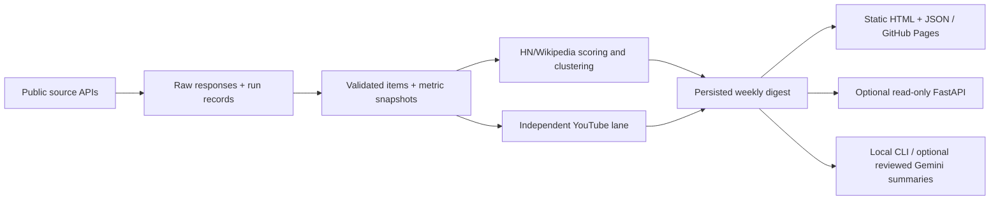

# Offscroll

A calm reading ritual with a clear ending. Offscroll collects public metadata from
Hacker News, Wikipedia and curated YouTube channels, selects up to 15 items in
separate source lanes, and links you to the originals. No infinite feed, accounts,
automatic playback, analytics or visitor AI calls.

**[Open Offscroll](https://sheralimfbads.github.io/offscroll/)** · New editions Monday,
Wednesday and Friday at **08:17 Asia/Tashkent**, subject to GitHub scheduling delays.
Free GitHub Pages hosting; no account needed to read.


[See the mobile view](docs/images/offscroll-mobile.png). Actual browser captures of
the live GitHub Pages edition, November 17, 2026. Release evidence is in
[PROGRESS.md](docs/PROGRESS.md).

A warm editorial interface, separate source sections, light/dark appearance,
browser-local saves and read progress, and YouTube players that connect only after
you choose. Works without JavaScript for core reading; add it to your phone’s home
screen for a quiet reading shortcut. Saved/read choices stay in that browser.
Use Safari’s share sheet or Chrome’s menu → Add to Home Screen. Internet is required.



Python 3.14 · PostgreSQL 18 · httpx · Pydantic · SQLAlchemy Core/psycopg · Alembic ·
FastAPI/Uvicorn · Jinja2 · pytest · Ruff · strict mypy. Buildless HTML/CSS/JavaScript; Node is used only for browser tests.

## Run in three commands

Prerequisites: a clone of this repository, Python from `.python-version`, GNU Make,
Docker Engine with Compose, and internet access for public collection. Run from
the repository root. On Linux, first configure a **new local development database**
in your shell; these settings are never read from `.env`:

```bash
export POSTGRES_USER=offscroll POSTGRES_DB=offscroll POSTGRES_PORT=5432
read -rsp 'New local database password: ' POSTGRES_PASSWORD; echo
export POSTGRES_PASSWORD
export DATABASE_URL="$(python3.14 -c 'import os; from urllib.parse import quote; print("postgresql+psycopg://" + quote(os.environ["POSTGRES_USER"], safe="") + ":" + quote(os.environ["POSTGRES_PASSWORD"], safe="") + "@127.0.0.1:" + os.environ["POSTGRES_PORT"] + "/" + os.environ["POSTGRES_DB"])')"
```

Then:

```bash
make setup
make collect-public
make site
```

Run `.venv/bin/offscroll doctor` after a full three-source collection/build/export.
For the keyless quickstart:

```bash
OFFSCROLL_SOURCES=hackernews,wikipedia .venv/bin/offscroll doctor
```

Keep test exports in a separate directory: doctor detects artifacts that do not
match the connected database.

Open `site/index.html`, or run `python3.14 -m http.server 8080 --bind 127.0.0.1
--directory site` and visit `http://127.0.0.1:8080`. Collection usually takes a
minute or two; source outages can delay it. The first run uses HN/Wikipedia and
needs no API key. A short or empty lane is valid; no filler is invented.
`make db-down` stops the local database and preserves its volume. Existing volumes
keep their original credentials; changing shell values does not reset a database.

## Everyday commands

```bash
make check                         # Ruff, strict mypy, offline unit tests
make test-integration              # disposable/test DATABASE_URL only
.venv/bin/offscroll status
.venv/bin/offscroll doctor           # source, lane and export consistency checks
OFFSCROLL_SOURCES=hackernews,wikipedia .venv/bin/offscroll check-data
.venv/bin/offscroll build-digest --week 2026-W46
.venv/bin/offscroll digest --week 2026-W46
.venv/bin/offscroll explain-digest
.venv/bin/offscroll purge-raw
make serve                         # optional web app at localhost:8000
make secrets                       # full Git history pattern scan, no account
```

Tests mock HTTP. Integration tests require a migrated test database and write test
rows; never point them at production. See [RUNBOOK](docs/RUNBOOK.md) for containers,
backup/restore, scheduling, deployment and troubleshooting. Local PostgreSQL and
source collection are independent of the static host.

## Sources and decisions

- HN and Wikipedia use explainable per-source scores and conservative clustering.
  Shared coverage is context, not factual proof. [Ranking](docs/RANKING.md).
- YouTube has an isolated lane: four slots at most, one video per channel, API-only
  query-time ordering, no stored or displayed derived score. Public pages contain
  video IDs/links only, so copied static pages cannot retain expired API metadata.
  An explicit Load player action opens the official privacy-enhanced YouTube
  player; Google supplies current details inside it.
  Local CLI reads can display fresh, unmodified API metadata. [ADR 0008](docs/decisions/0008-m4-youtube-scoring.md).
- Optional local Gemini uses the stable configurable `gemini-2.5-flash-lite` free
  tier. Billing must remain **disabled**. No key means deterministic templates;
  provider errors also fall back. Public exports/web always use templates.
  [ADR 0009](docs/decisions/0009-summary-provider.md).
- GitHub Pages + standard GitHub Actions is the free-first launch target. A fresh
  disposable PostgreSQL database builds each edition; no hosted DB account is
  needed. A checked edition replaces the last one only after successful collection.
  [Recurring editions ADR](docs/decisions/0015-free-recurring-editions.md).
- A filtered SQL backup omits YouTube API data and expires after seven days.
  [Backup ADR](docs/decisions/0011-backups-and-operations.md).

For YouTube, review `config/youtube_channels.yaml`, read the official policies,
then export YOUTUBE_API_KEY through a secure local prompt. Enable all sources
with `OFFSCROLL_SOURCES=hackernews,wikipedia,youtube`. No `search.list`, scraping,
video downloads or thumbnail downloads. Local category labels never reach digests.

## Privacy and optional AI

Offscroll has no user accounts or analytics. It sets no cookies. Saved/read
choices and appearance preferences use this browser’s local storage only, never
a server. Item state expires on the next visit after 30 days; Clear my local
preferences removes it. Saves refer only to items still in the current edition.
Hosting providers and linked sites have their own logging/privacy policies.
Loading a YouTube player shares your IP address and site origin with Google; its
player may store data and show ads. Nothing connects to YouTube before that choice. Public API metadata may
contain personal data; being public does not make it suitable for model input.

Gemini may receive **only** title, source, domain, and an optional source-provided
description/extract. Never article bodies, authors/usernames, personal/sensitive
data, YouTube data or visitor input. Current connectors do not fetch article
extracts. Free-tier content may improve Google products and may be read by human
reviewers. Uzbekistan is supported as checked on 2026-11-16; current provider
terms and the project's billing settings still need owner review.

Before local use, run `.venv/bin/offscroll summary-inputs` and review each exact
input. Add only nonpersonal, nonsensitive approved hashes to the JSON array in
`config/summary_public_inputs.json`. Keep that review list empty if uncertain.
Set GEMINI_API_KEY via a hidden prompt; GEMINI_MODEL is configurable. Changed input
requires renewed approval. No approved inputs means no transmissions, even with
a key. Credentials come only from exported environment variables, never `.env`.

The adapter validates JSON, caps requests at 50/day across processes, caches
successful outputs and records model/prompt/hash/token usage. Local model output
is labelled **AI-generated summary** and may be inaccurate. Templates are labelled
Source context. Global public delivery uses templates because offline generation
does not establish an exemption from the EEA/CH/UK paid-service requirement.
Groq is a future operational fallback, not an automatic second data recipient.

Optional local hooks: `pipx install pre-commit`, then `pre-commit install`.
The optional pre-commit tool runs the same lint/type/test and staged-secret checks
before commits; it is not a runtime dependency.

## Limits, status and next steps

This is a portfolio project, not a news verification service. Curated coverage,
API freshness, topic matching and heuristic ranks can miss important stories.
No historical point-in-time reconstruction is promised. YouTube policy language
around derived ordering retains the uncertainty recorded in ADR 0008. Cleanup
needs a running job. The new Monday/Wednesday/Friday workflow is gated by ENABLE_EDITIONS;
activation and remote CI/publication are recorded separately from local tests.
Playwright checks desktop/mobile interaction and axe checks light/dark accessibility;
these do not replace a complete assistive-technology audit. A current Starlette test-client deprecation
warning does not affect passing tests; dependency upgrades should revisit it.

[Architecture](docs/ARCHITECTURE.md) · [Learning walkthroughs](docs/HOW_IT_WORKS.md) ·
[Compliance mapping](docs/COMPLIANCE.md) · [Progress/evidence](docs/PROGRESS.md) ·
[Owner maintenance guide](docs/OWNER_TODO.md) · [Security](SECURITY.md).
No license is selected yet; do not assume a license grant for this code or assets.

Future experiments, each requiring a separate policy/design review: news RSS,
Google Fact Check API, an X connector, dbt transformations and Dagster orchestration.

## Browser checks and a safe cloud rehearsal

```bash
npm ci
npx playwright install chromium
make test-browser
.venv/bin/python scripts/check_postgres.py
```

The first three commands check responsive layout, saves/read progress, consent before
player loading, empty/stale states, blocked storage and automated accessibility.
The final command creates its own temporary PostgreSQL container for the integration
suite and removes it afterward. It never uses your existing DATABASE_URL.

For an optional real API rehearsal, export YOUTUBE_API_KEY locally, then run
`.venv/bin/python scripts/check_postgres.py --live`. This calls the three sources
and writes only `build/cloud-rehearsal/site/`; it never overwrites your owner export.
The cloud workflow uses the same migrated pipeline and adds a conservative GitHub
run-history quota guard. See [the launch runbook](docs/RUNBOOK.md#m7-free-recurring-editions).
