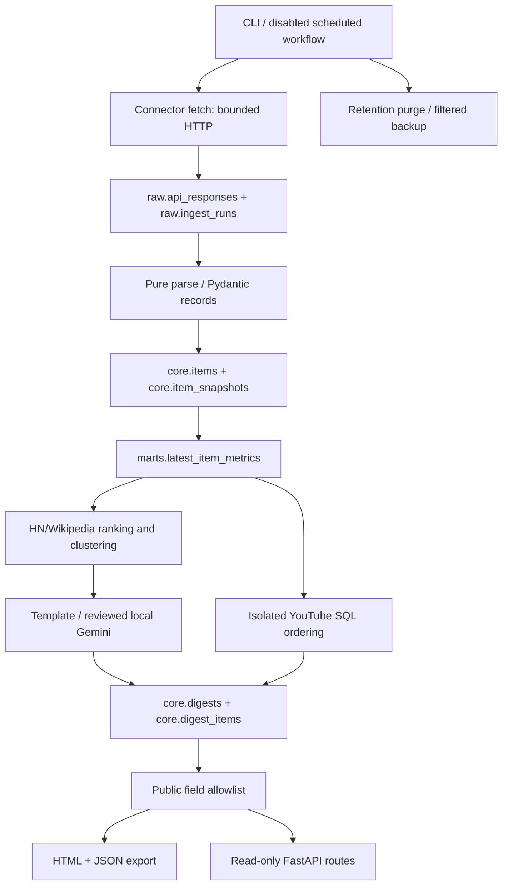
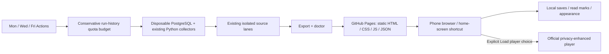

# Architecture

Offscroll is a batch metadata pipeline with two read-only delivery formats.
PostgreSQL is the source of truth. The static export needs no database or Python
at serving time; FastAPI is optional for local delivery.

## Boundaries and module map

| Module | Responsibility |
| --- | --- |
| `config.py`, `db.py` | Environment-only masked settings and engine factory |
| `connectors/` | Source-specific fetch/parse, public APIs, bounded retries/pacing |
| `pipeline.py` | Atomic ingestion, upserts, snapshots, safe run diagnostics |
| `operations.py`, `retention.py` | Freshness checks, run-all isolation, expiration |
| `ranking.py` | Pure HN/Wikipedia formulas/clusters/caps |
| `digests.py` | SQL-only YouTube ordering, transactional replacement, summary cache |
| `summaries.py` | Reviewed input boundary, Gemini JSON validation, immediate templates |
| `quota.py` | Durable daily YouTube units and Gemini call reservations |
| `delivery.py`, `templates/`, `static/` | Public projection, escaping, finite page, atomic files |
| `web/` | GET-only routes; no provider calls or request-time writes |
| `backups.py` | pg_dump schema + filtered SQL data, empty-target restore, expiry |
| `cli.py` | Explicit batch commands and safe user-facing errors |

Migrations 0001–0004 own database structure; do not edit applied migrations.
Each ingestion run uses one transaction with a savepoint so ordinary failures can
retain a safe run record without partial data. Source identity is unique; replay
upserts items while preserving one snapshot per run. Durable quotas use independent
transactions so rollback cannot refund API calls. Digest replacement is atomic;
a failed rebuild leaves the previous edition intact.

HN/Wikipedia use source-relative metrics and coverage clusters. YouTube never
enters those functions: SQL computes a private ordering expression and returns
only selected records. Database constraints require NULL YouTube score, empty
cluster/breakdown and ID/link-only archive content. Lane caps are 6/5/4; no backfill.

Summary cache identity includes public input, model and prompt version. The optional
Gemini adapter requires a key plus exact-input approval, reserves one of 50 daily
calls, validates the response and falls back on any error. Model output remains
local; public delivery projects template context instead. Visitors never trigger
collection, model requests, ranking, or purge. The web database account should have
read-only access; CLI collection/maintenance uses a separate account in production.

## Operations and threat model

Everything from sources is untrusted. HTML is escaped, URLs are filtered, model
inputs are serialized data, errors omit remote bodies and credentials. Public
artifacts contain no YouTube API metadata and no Gemini output. A static page may
remain online indefinitely, so expiry-sensitive information is excluded rather
than relying on a browser clock. No downloaded media is stored.

Source failures, stale data and quota exhaustion are observable through status,
check-data, safe run records and nonzero CLI exit codes. Checks cannot establish
truth or complete coverage. Run purge daily, keep filtered backups at most seven
days, rehearse restore, and monitor the workflow after the owner enables it.
See [RUNBOOK](RUNBOOK.md), [COMPLIANCE](COMPLIANCE.md), and ADRs 0008–0011.

## M7 public edition path

The server never receives reading preferences. No page request invokes an LLM or
collector. JavaScript is optional for core reading. The public bundle contains no
source credentials or copied YouTube metadata. Failed cloud builds keep the last
successful deployment. The existing local persistent Postgres/FastAPI path remains
available; this cloud path does not expose it or require a paid database.
